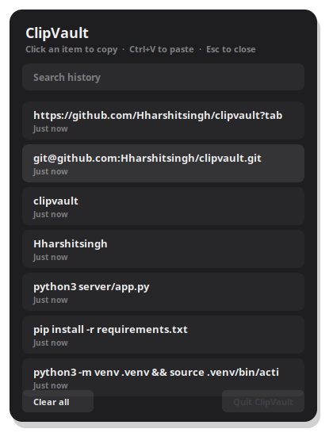
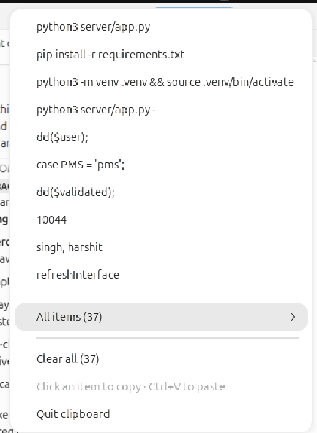

<p align="center">
  
</p>

<h1 align="center">ClipVault</h1>

<p align="center">
  <strong>Windows 11–style clipboard history for Linux.</strong><br>
  Super+V · top-bar icon · pin · search · images · GNOME-safe.
</p>

<p align="center">
  <a href="LICENSE"></a>
  <a href="https://github.com/Hharshitsingh/clipvault/releases"></a>
  
  
</p>

<p align="center">
  <a href="#install">Install</a> ·
  <a href="#usage">Usage</a> ·
  <a href="#how-it-works">How it works</a> ·
  <a href="#uninstall">Uninstall</a>
</p>

---

Copy something. Press **Super+V**. Click it. Paste with **Ctrl+V**.

That’s the Windows 11 clipboard — on GNOME, without the keyboard lag and notification spam that naive Wayland clipboard tools cause.

<p align="center">
  
  &nbsp;
  
</p>

## Features

| | |
|---|---|
| **Super+V flyout** | Searchable history of the last 50 copies |
| **Top-bar icon** | Recent items at a glance · **All items** opens the flyout |
| **Text + images** | PNG, JPEG, WebP, BMP, GIF — stored as PNG |
| **Pin** | Keep important clips when you Clear all |
| **Theme-aware** | Follows system light / dark |
| **GNOME-safe** | No focus steal, no screen blink, no “wl-clipboard is ready” |

## Install

### Debian / Ubuntu (`.deb`)

```bash
# from a release: https://github.com/Hharshitsingh/clipvault/releases
sudo apt install ./clipvault_1.0.0_all.deb
clipvault
```

### From source

```bash
git clone https://github.com/Hharshitsingh/clipvault.git
cd clipvault
chmod +x install.sh
./install.sh
```

This installs `~/.local/bin/clipvault`, autostart, the dock icon, the tray, and binds **Super+V**. History from the earlier `clipboard-manager` install is migrated automatically.

Optional (tray typelib if the bundled one is missing):

```bash
sudo apt install gir1.2-ayatanaappindicator3-0.1
```

`wl-clipboard` / `wtype` are **not needed on GNOME**. They only help on wlroots compositors (Sway, Hyprland).

## Usage

| Action | How |
|--------|-----|
| Open history | **Super+V**, tray icon, or `clipvault-toggle` |
| Copy an item | Click it (or search and press Enter) |
| Paste | **Ctrl+V** in the target app |
| Pin / unpin | Star |
| Delete | Trash |
| Clear unpinned | **Clear all** |
| Close flyout | **Esc** or click away |

GNOME used Super+V for notifications. ClipVault remaps that to **Super+M**.

On GNOME, clicking an item **copies** it — then press Ctrl+V. Mutter cannot inject keystrokes. On Sway / Hyprland with `wtype`, paste is automatic.

## How it works

Mutter (GNOME’s compositor) has no wlroots `data-control` protocol. Tools like `wl-paste` work around that by opening an **invisible window on every call**. Polling that from a background app:

- steals keyboard focus (typing lags)
- flashes the display
- posts “wl-clipboard is ready” over and over

ClipVault avoids that. On GNOME it runs as an **XWayland** client (`GDK_BACKEND=x11`). Mutter mirrors the Wayland clipboard into X11, and change notifications arrive with **no window and no focus**. `wl-clipboard` is used only on compositors that actually support `data-control`.

Override if you must: `CLIPVAULT_BACKEND=wayland` or `x11`.

History lives in `~/.local/share/clipvault/`.

## Uninstall

```bash
./uninstall.sh          # keeps history
./uninstall.sh --purge  # also deletes history
```

Or, if installed from the `.deb`:

```bash
sudo apt remove clipvault
```

Super+V is handed back to GNOME notifications.

## Development

```bash
./run.sh          # start in the foreground
./run.sh --toggle
```

See [CONTRIBUTING.md](CONTRIBUTING.md).

## License

[MIT](LICENSE) © 2026 Harshit Singh
